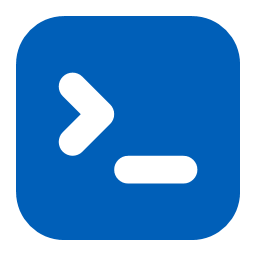
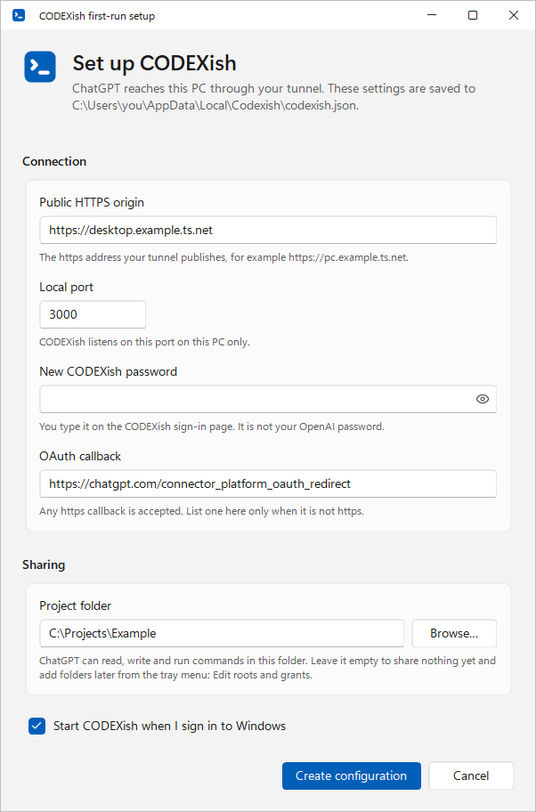
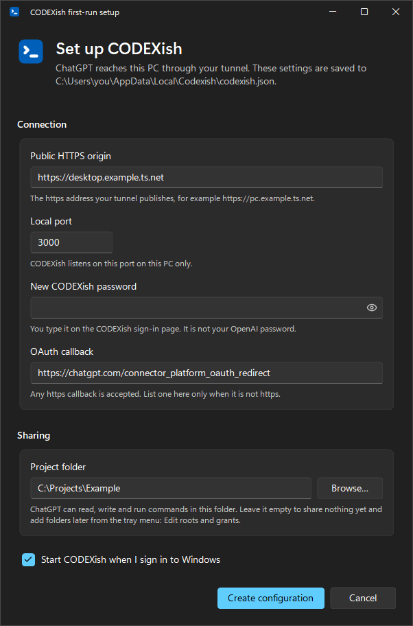
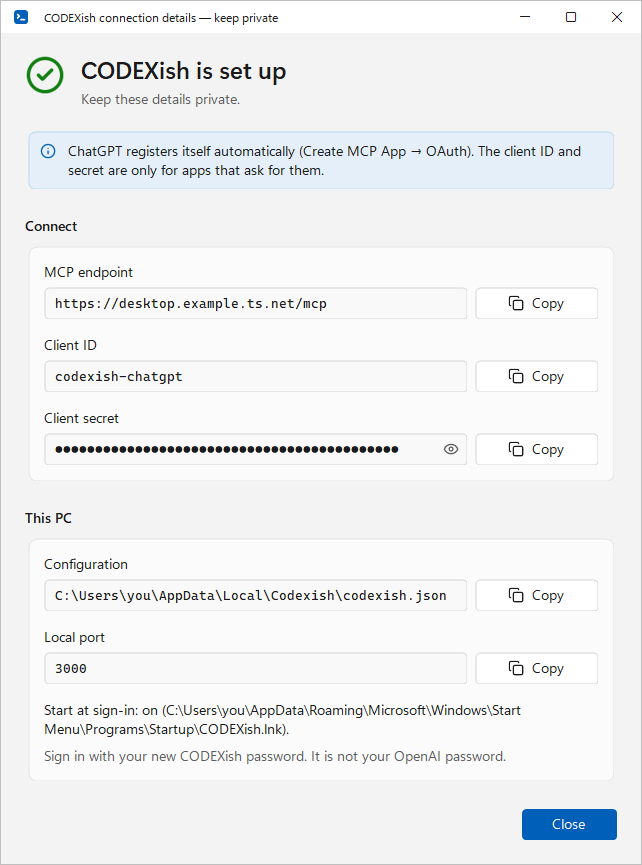
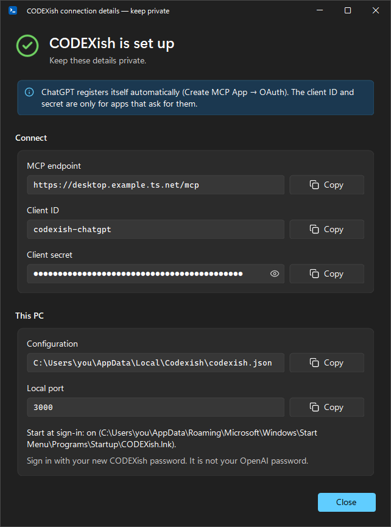
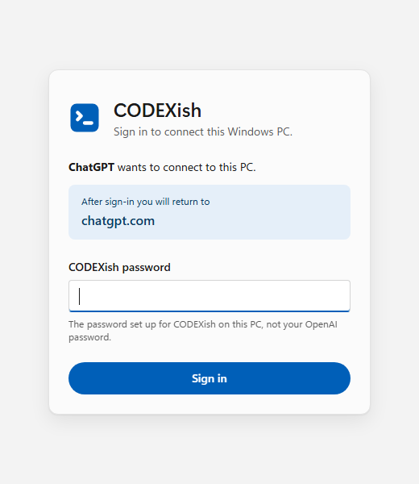
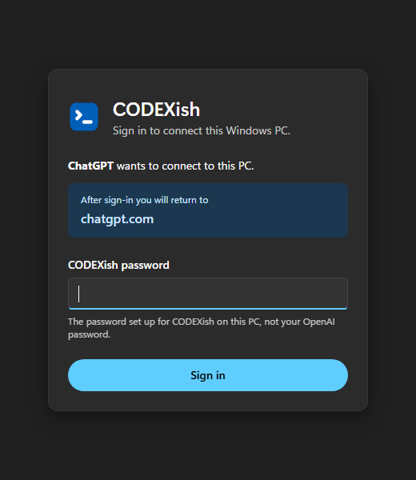
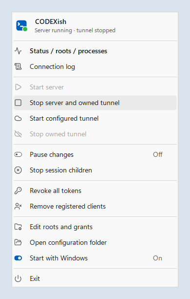
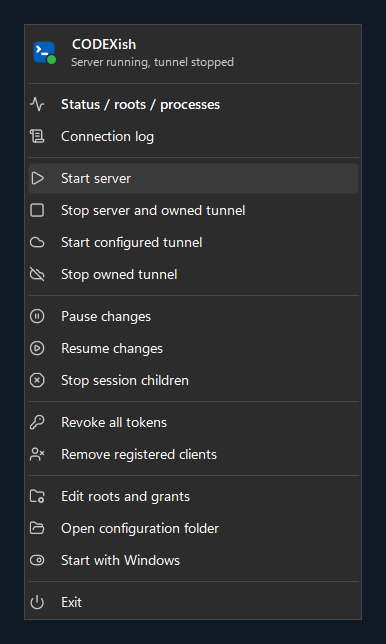

<p align="center"></p>

<h1 align="center">CODEXish</h1>

<p align="center">Let ChatGPT work on your Windows PC: files, commands, Git and the desktop, through one MCP server.</p>

CODEXish is a single self-contained Windows program. It gives a ChatGPT MCP app the kind of access a local coding agent has, so you can hand
coding and computer-use work to ChatGPT, including GPT Pro, inside an ordinary chat. It runs in the notification area, starts with Windows, signs ChatGPT in
with OAuth and a password you choose, and keeps working on its own: failed parts restart, damaged state is set aside
and rebuilt, and old output is cleaned up.

| | Light | Dark |
|---|---|---|
| First-run setup |  |  |
| Connection details |  |  |
| Sign-in page |  |  |
| Tray menu |  |  |

## What ChatGPT gets

24 tools. Paths are relative to the folders you share ("roots"), and each root has its own Read, Write and Shell
switches.

| Area | Tools |
| --- | --- |
| Orientation | `host_capabilities`, `workspace_info` |
| Files | `fs_list`, `fs_stat`, `fs_read`, `fs_search`, `fs_write`, `fs_apply_patch` |
| Commands | `shell_run` (pwsh, Windows PowerShell or cmd), `process_start`, `process_poll`, `process_write`, `process_stop` |
| Git (read-only) | `git_status`, `git_diff`, `git_log` |
| Long output and retries | `artifact_read`, `artifact_search`, `operation_inspect`, `operation_cancel`, `session_checkpoint` |
| Desktop | `computer_observe` (screenshot plus UI Automation tree), `computer_query_ui`, `computer_act` (click, type, keys, scroll, drag, window focus) |

Writes need the hash from the last read, so ChatGPT never overwrites a file that changed under it. A long command
returns a handle instead of being killed, and a retried request never runs twice. Optional browser tools can be
mounted from an existing browser MCP server such as Playwright MCP (see [Browser mounts](docs/reference.md#browser-mounts)).

## What you need

- Windows 10 or 11, x64. Nothing else to install: the .NET runtime is bundled.
- A ChatGPT plan with **Developer mode**: Plus, Pro, Business, Enterprise or Edu. On a workspace plan an admin may need
  to allow it.
- A public HTTPS address for this PC. [Tailscale Funnel](https://tailscale.com/kb/1223/funnel) is free and gives a
  stable address, and the steps below use it.

## Install

1. Download `CODEXish-<version>-win-x64.zip` from the
   [latest release](https://github.com/EVSkyFall/CODEXish-MCP-for-Pro/releases/latest). Its `.sha256` file holds the
   checksum, which you can verify with `Get-FileHash`.
2. Extract the zip to `%LOCALAPPDATA%\Programs\Codexish`.
3. Choose a local port that nothing else uses, for example `38451`. Anything listening on the published port is
   reachable from the internet.

The program is not code-signed, so Windows SmartScreen may ask once before it runs it.

## Publish it with Tailscale Funnel

Install [Tailscale](https://tailscale.com/download) and sign in. Then, in a terminal:

```powershell
tailscale set --unattended
tailscale funnel --bg --https=443 http://127.0.0.1:38451
```

- `--unattended` keeps Tailscale running while you are signed out of Windows, and `--bg` keeps the funnel across
  restarts.
- In the Tailscale admin console, **disable key expiry** for this machine. Otherwise it drops off the tailnet when its
  key expires.
- Your address is `https://<machine>.<tailnet>.ts.net`; `tailscale funnel status` shows it.

## First run

Start the tray once:

```powershell
& "$env:LOCALAPPDATA\Programs\Codexish\Codexish.Server.exe" --tray --public-url https://<machine>.<tailnet>.ts.net --port 38451
```

The setup window asks for the following:

- **Public HTTPS origin and local port.** They are filled in from the command.
- **A new CODEXish password.** ChatGPT's sign-in page asks for it. It is not your OpenAI password.
- **A project folder to share.** You can leave it empty and add folders later.
- **Start CODEXish when I sign in to Windows**, which is on by default.

**Create configuration** saves `%LOCALAPPDATA%\Codexish\codexish.json`, shows the connection details, and starts the
server. The tray icon shows the state with a dot: green running, grey stopped, amber needs attention.

## Connect ChatGPT

1. On [chatgpt.com](https://chatgpt.com), open **Settings → Security and login** and turn on **Developer mode**.
   Some accounts already have the next step without a toggle.
2. Open [chatgpt.com/plugins](https://chatgpt.com/plugins), choose **Add**, then **Create MCP App**, and fill it in:
   - **Name:** CODEXish.
   - **Description:** for example "Use this when the user wants work done on their own Windows PC: files, builds,
     tests, Git, desktop apps."
   - **Server URL:** `https://<machine>.<tailnet>.ts.net/mcp`.
   - **Authentication:** OAuth.

   Tick **I understand and want to continue**, then choose **Create**.
3. ChatGPT registers itself and opens the CODEXish sign-in page. Check that it says you will return to
   **chatgpt.com**, then enter your CODEXish password.
4. ChatGPT lists the 24 tools. In a new chat, open **+**, choose **Developer mode**, and turn on CODEXish.

The client ID and secret in the connection details are only for apps that ask for them; ChatGPT does not.
**Create plugin** and **Upload plugin archive** on the same page are for packaged plugins; on the web they may say the
desktop app is required. You do not need them.

## Using it

- **Start small.** First ask "Show host_capabilities and the workspace roots of my PC." A Thinking model is enough for
  this check.
- **Give whole tasks.** CODEXish is built for long tasks. Describe the goal and how to verify it, for example "The
  tests in `game` fail. Fix them until they pass; do not stop to ask."
- **Add the custom instructions.** For a ChatGPT Project, paste the
  [Project custom instructions](docs/reference.md#project-custom-instructions). They keep the working rules in
  place: read before writing, poll long commands, report real exit codes.
- **Desktop work.** ChatGPT observes before it acts. Do not use the PC's mouse and keyboard while it works on the
  desktop.
- **Two conversations at once.** CODEXish cannot tell conversations apart, so keep them out of each other's way:
  - Give each conversation its own folder, for example a git worktree shared as a separate root.
  - Run desktop work in one conversation at a time.
  - Name a `task` for each line of work, for example "checkpoint as task login-fix". `session_checkpoint` then keeps
    a separate checkpoint for each one, and `host_capabilities` lists them all.
  - The instructions tell ChatGPT to make every `invocation_id` unique for each new action, a short word plus a
    random suffix such as `run-tests-7f3a9c2e`, because other conversations may use the server at the same time. It
    reuses one only to retry the identical action.

## Everyday control

Right-click the tray icon. The first line of the menu, and the icon's tooltip, name every state that is not the
default, for example "Server running · changes paused".

| Item | What it does |
| --- | --- |
| Status / Connection log | Roots, processes, registered clients; every connection and failure with its cause |
| Start / Stop server | Stop ends supervision until you start again |
| Pause changes | A switch. On: writes wait in their queue; reads keep working. Off: they run again |
| Stop session children | Ends the processes ChatGPT started |
| Revoke all tokens | Signs ChatGPT out; it asks for the password again |
| Remove registered clients | Forgets every registered app and its tokens |
| Edit roots and grants | Folders and their Read / Write / Shell switches; saving restarts the server briefly |
| Start with Windows | A switch for the Startup-folder shortcut |

- **Switches show their state twice.** On is a filled switch with the word **On** beside it; off is an outline with
  **Off**.
- **Items grey out when they do not apply.** Examples are **Start server** while the server runs, and **Pause
  changes** and the session, token and client items while it is stopped.
- **Every action that changes something confirms what happened** with a notification, for example "Server started
  on port 38451." Windows may hold notifications back, for example under Do Not Disturb; the menu always shows the
  current state.

**Updating.** Choose **Exit** in the tray, extract the new zip over `%LOCALAPPDATA%\Programs\Codexish`, then start it
again. Your configuration and sign-ins stay in `%LOCALAPPDATA%\Codexish`.

**Uninstalling.** Choose **Exit**, then turn off **Start with Windows** or delete `CODEXish.lnk` from your Startup
folder. Delete both folders, and turn off the funnel with `tailscale funnel --https=443 off`.

## Safety model

CODEXish is a key to your PC; treat it like one.

- **No sandbox.** Commands, builds, tests and Git hooks run with your full Windows rights. Roots and grants decide
  which folders the file tools accept and where commands start. They do not contain what a command does.
- **Who can get in.** Only someone who passes the sign-in page with your password. Anyone can reach the page and
  register an app name, but nothing is issued without the password. Use a strong one.
- **Every sign-in names its destination.** Check it before you type the password.
- **Your controls.** Revoke tokens or remove clients from the tray at any time. Pause holds every change.
- **What is never touched.** Secrets in output are redacted with a small published pattern set; it is not a guarantee.
  CODEXish never reads credential stores, never uses the clipboard as a tool and never elevates.

The complete list of limits and known gaps is in the [reference](docs/reference.md#limits-and-known-gaps).

## Troubleshooting

| Symptom | Cause and fix |
| --- | --- |
| The plugin dialog says the website is unavailable and offers to open the desktop app | You chose **Create plugin** or **Upload plugin archive**. Use **Add → Create MCP App**. |
| ChatGPT cannot reach the server | Open `https://<machine>.<tailnet>.ts.net/healthz` from a phone on mobile data; it should answer `200`. On the PC itself Tailscale resolves the name to its private `100.x` address, so a check from the PC does not prove public reachability. Check `tailscale funnel status` and that the tray dot is green. |
| `host_capabilities` warns "No usable root is configured" | No folder is shared yet. Add one in **Edit roots and grants**. |
| cmd commands fail with "is not recognized as an internal or external command" | Your `PATH` is longer than 8,191 characters, which cmd.exe cannot handle. Remove entries that no longer exist from the user `PATH`. If many are `…\.dotnet\tools`, set the user environment variable `DOTNET_ADD_GLOBAL_TOOLS_TO_PATH=false` so .NET stops adding them. |
| ChatGPT asks for the password again | Tokens were revoked, or a damaged ledger was rebuilt (`host_capabilities.ledger_rebuilt`). Sign in again. |
| The tray dot is amber | Something is retrying. The connection log names the cause, for example a busy port. CODEXish keeps retrying on its own. |
| ChatGPT reports `Internal error` on every CODEXish call and the tray icon is gone | The CODEXish process ended. After the next start, `host_capabilities` and the connection log say how: "The previous CODEXish … ended without stopping" means it was ended from outside, usually together with the program it was started from. Start CODEXish from the Start menu or the sign-in shortcut, not from a terminal inside another app such as Claude Code. See [Why a server stopped](docs/reference.md#why-a-server-stopped). |
| `host_capabilities` warns "Windows redirects state_dir" | CODEXish was started from inside a packaged app such as Claude Desktop, so its files went into that app's private folder, programs outside that app cannot see them, and the app can end CODEXish without notice. See [Why a server stopped](docs/reference.md#why-a-server-stopped). |

## Building from source

Install the [.NET 10 SDK](https://dotnet.microsoft.com/download), then:

```powershell
dotnet publish src/Codexish.Server -c Release -r win-x64 --self-contained true -o "$env:LOCALAPPDATA\Programs\Codexish"
dotnet run --project src/Codexish.Server -c Release -- --self-test
dotnet run --project src/Codexish.Server -c Release -- --browser-tests
dotnet run --project src/Codexish.Server -c Release -- --tray-tests
```

- **CI.** The three suites run on Windows and Ubuntu for every pull request and every push to `main`.
- **Releases.** Pushing a `v*` tag runs the suites again on Windows and attaches the zip and its checksum to a GitHub
  release.
- **Other checks.** The live desktop tests, `--design-preview` and the icon build are described under
  [Tests](docs/reference.md#tests).

## Documentation

- [Security policy](SECURITY.md): the security model, what is in and out of scope, and how to report a vulnerability.
- [Reference](docs/reference.md): configuration, OAuth, checkpoints and parallel conversations, the control API,
  shells and Git, the ledger and retention, browser mounts, the tray, tests, and limits.
- [Design](docs/v1-design.md) and [plan](docs/v1-plan.md).
- [Implementation status](IMPLEMENTATION_STATUS.md).
- [P0 probe](docs/p0-probe.md): the original measurement fixture in `src/Codexish.P0`.
- [Third-party notices](THIRD_PARTY_NOTICES.md): Lucide icons, ISC.

## License

CODEXish is licensed under the [Apache License 2.0](LICENSE). It is provided "as is", without warranties or
conditions of any kind, and the authors are not liable for any damage arising from its use (sections 7 and 8 of the
license). Bundled third-party components keep their own licenses; see [NOTICE](NOTICE) and
[THIRD_PARTY_NOTICES.md](THIRD_PARTY_NOTICES.md).
